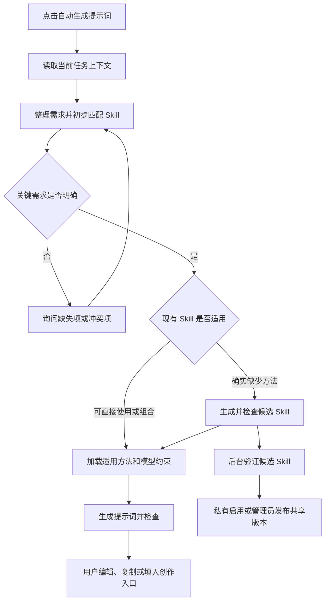

# 自动生成提示词：调研与产品需求草案

日期：2026-10-15。状态：调研草案；第一版已实现，实际范围和部署说明见 [提示词助手实现说明](prompt-assistant-implementation.md)。

已确认：第一版以图片、视频生成提示词为主。用户希望系统主动询问需求、匹配管理员内置的开源 Skills，并在缺少匹配能力时自动生成可复用 Skill。

## 1. 功能定义

用户用自然语言描述想制作的内容，系统结合当前页面、素材、画风和目标模型，补齐关键需求，选用适用的创作方法，生成可编辑、可复制、可直接填入创作入口的提示词。缺少适用方法时，自动生成候选 Skill，并通过检查和后续案例验证积累到技能库。

这里有三个不同的对象：

| 对象 | 回答的问题 | 例子 |
| --- | --- | --- |
| 需求简报 Brief | 本次要制作什么，有哪些限制？ | 一款保温杯、突出便携、竖屏视频、写实、产品外形固定 |
| Skill | 同类任务应该怎样做？ | 产品展示视频如何组织卖点、动作、镜头和连续性 |
| 提示词 Prompt | 这次交给图片或视频模型什么？ | 描述指定保温杯、场景、动作、镜头和约束的具体指令 |

Skill 可以为多个产品生成不同提示词。产品名称、价格、上传图片和一次性参数保存在 Brief 中；可复用的方法保存在 Skill 中。

第一版的交付是提示词及必要的素材要求。用户点击图片或视频创作入口的生成命令后，才提交媒体生成任务并按相应规则计费。

## 2. 调研依据和可借鉴的开源项目

以下是实际读取的官方规范或仓库内容。适用性判断是本项目的设计建议，不代表已经验证其生成效果。

| 来源 | 已核实内容 | 对本功能的用途和边界 |
| --- | --- | --- |
| [Agent Skills 规范](https://agentskills.io/specification) | `SKILL.md` 使用 YAML 元信息和 Markdown 正文；`name`、`description` 必填；可包含 references、assets、scripts | 用作 Skill 导入和导出的兼容格式；规范没有规定本产品的业务分类和匹配评分 |
| [Agent Skills 接入指南](https://agentskills.io/client-implementation/adding-skills-support) | 先发现名称和描述，命中后加载正文，按需加载资源；服务端可通过工具或程序注入正文 | 不必把所有 Skill 正文塞进一次模型请求；普通文本模型也可以由服务端提供选中的内容 |
| [Agent Skills 质量评估指南](https://agentskills.io/skill-creation/evaluating-skills) | 用真实任务、预期结果、使用 Skill 与不使用 Skill 的对照验证效果；建议先从 2–3 个案例开始 | 区分格式合格、提示词内容合格和实际图片/视频效果合格 |
| [anthropics/skills](https://github.com/anthropics/skills) 中的 [skill-creator](https://github.com/anthropics/skills/tree/dbd4588f9e1033efb41dad4bef2f7947c8993d44/skills/skill-creator) | 提供需求获取、Skill 草稿、测试、评价和迭代方法；该 Skill 的 `LICENSE.txt` 为 Apache-2.0 | 借鉴新 Skill 的生成与评价流程；其面向 Agent 的工具调用、脚本和环境约定需要适配 |
| [coreyhaines31/marketingskills](https://github.com/coreyhaines31/marketingskills/tree/55ff469422c3592dac45bcad08dfb40221981c02) | 仓库为 MIT；实际读取 product-marketing 相关介绍以及 image、video、ad-creative Skills | 可以提供营销信息采集、创意组织、图片和视频任务分类的素材；原版含制作、外部工具和 API 相关步骤，不能直接等同于提示词生成器 |
| [agentskills/agentskills 的 skills-ref](https://github.com/agentskills/agentskills/tree/69ef37e9424c0a7ea9dd2293b559e43ec8176379/skills-ref) | Apache-2.0；支持元信息读取、格式校验、目录生成；README 明确标注仅作演示，不用于生产 | 可参考格式检查逻辑和测试夹具，不建议直接作为本项目的生产运行依赖 |

本次查询的仓库版本：

- `agentskills/agentskills`：`69ef37e9424c0a7ea9dd2293b559e43ec8176379`。
- `anthropics/skills`：`dbd4588f9e1033efb41dad4bef2f7947c8993d44`。
- `coreyhaines31/marketingskills`：`55ff469422c3592dac45bcad08dfb40221981c02`。

内置时按具体 Skill 及其引用资源核对许可证，保留来源、版权声明、原始版本和本地改动。Anthropic 仓库的 README 明确区分开源示例与仅公开源码的文档类 Skills，不能把整个仓库统一标成 Apache-2.0。

开源 Skill 的模型推荐、价格和参数表只能作为线索。实际模型限制应来自系统配置和当前供应商文档；本次没有验证上述库的模型比较或价格准确性，也没有跑生成质量对照实验。

## 3. 用户流程



Skill 初步匹配可以在询问期间进行，用来判断下一步应该问什么。每次回答更新 Brief 后重新检查适用性。

### 入口和结果

- 图片/视频速创：在输入区提供“自动生成提示词”，自动带入当前媒体类型、已选模型、风格预设和素材引用。
- 独立“提示词”页面：适合从零开始、管理历史结果，以及复制到其他生成工具。第一版可与速创共用同一套服务。
- 对话区：自然语言输入与少量选择项结合，支持自由回答、“暂不确定”和“按推荐方案”。
- 需求摘要：展示本次目标、产品/主体、输出规格、画风和素材。修改某个字段后，相关提示词版本标记为需要更新。
- 结果区：图片展示一条完整提示词；视频根据需求展示单段提示词或分镜提示词组。保留编辑、复制、重新生成、填入速创、保存模板和查看历史版本等命令。
- 未确认项：展示对结果有实际影响的缺失素材或默认假设，避免用户误以为系统掌握了未提供的信息。

用户不必学习 Skill 名称或手动选择 Skill；来源和方法可在结果详情中查看。更改描述、素材或模型后，系统应重新检查方法与参数。

### 自适应询问规则

1. 优先读取已有信息，已在当前任务或项目中明确的内容不重复询问。
2. 每轮建议最多询问 2–3 个相关问题；这是体验目标，关键需求仍未明确时允许继续询问。
3. 主体、媒体形式、核心目标不明确时优先补齐。没有这些信息，系统无法判断应生成什么。
4. 画风或硬约束出现矛盾时，询问本次采用哪一个，或是否需要拆成不同镜头/不同输出。
5. 可合理默认的项目用推荐值补齐，并记录为系统建议；不把默认值说成用户要求。
6. 用户提供完整需求时直接生成。用户表示“你来决定”时只对不可推断的关键事实追问。
7. 缺少产品参数、素材或型号限制时记录未知状态；用户真实卖点、功能、价格和承诺不能由模型编造。

### 一段示例对话

用户：“我想给保温杯做一个视频。”

系统首轮：“这款杯子最想突出哪一个卖点？视频准备发在哪里、想做多长？”

用户：“轻便，发抖音，15 秒。”

系统结合当前上下文，只追问缺失项：“有产品照片可以用吗？画面希望是日常使用场景，还是纯产品展示？”

用户：“有照片，纯产品展示，写实。”

系统生成摘要：产品营销／保温杯／竖屏 15 秒／轻便／产品展示／写实／产品图片为外观依据。分辨率和片段能力按当前模型配置检查；未提供重量数值，不编造克重。

输出可以是一个片段，也可以是若干相邻镜头的提示词组，取决于目标模型和用户选择。若单次调用不能满足 15 秒，则拆分或请用户选择其他模型。

## 4. 需求维度：避免再次出现互斥选项混在一起

“营销产品、宣传片、图片、视频”属于不同维度。产品营销可以同时选择视频和写实画风；它们不应该放进同一组互斥选项。

| 维度 | 示例 | 规则 |
| --- | --- | --- |
| 商业/创作目的 | 产品营销、品牌宣传、故事表达、产品展示 | 可有主次目标；用于选择创作方法 |
| 主体类型 | 实体商品、软件服务、人物、场所、虚构角色 | 单次任务可以有多个主体，明确主角 |
| 交付媒体 | 图片、视频 | 每个生成任务选择一种；同时需要两种时拆成有关联的交付 |
| 交付结构 | 单图、系列图、单段视频、多镜头视频 | 不能把多镜头要求强塞进只适合单段的输出 |
| 使用场景 | 电商详情、社交平台、网站、广告投放 | 可以复用，但规格分别检查 |
| 目标受众和卖点 | 潜在人群、痛点、一个核心卖点 | 营销任务重点采集，普通风景图不强制回答 |
| 生成方式 | 文生图、图生图、文生视频、图生视频 | 根据实际素材和模型能力选择 |
| 主画风和风格预设 | 写实、二维动漫、3D；已选预设 | 同一交付范围内主画风单选，沿用已有规则 |
| 场景和镜头表现 | 地点、时间、动作、构图、镜头运动 | 图片与视频分别采集；分镜局部参数不变成全片统一参数 |
| 目标模型和规格 | 模型、比例、时长、参考素材限制 | 来自系统配置；用户不确定时用推荐值 |
| 不可违反的要求 | 外观、Logo、指定文案、不可出现的内容 | 单独保存并用于检查；不靠关键词堆叠表达 |

Brief 中每个关键字段保留来源：用户明确输入、当前页面继承、系统建议、仍未知。默认先使用当前项目设置；与用户本次明确要求冲突时提出可执行的解决选项。

已有风格规则见 [style-selection-rules.md](./style-selection-rules.md)。新功能应调用同一份规则，而不是再维护一套画风分类或让 Skill 擅自指定另一个主画风。

## 5. Skill 匹配规则

### 管理员维护的索引

保留标准 `SKILL.md` 文件，同时由系统维护业务索引：

- 名称、描述、适用媒体、目标任务、主体类型、适用范围和不适用场景。
- 所需输入、交付类型、引用资源和工具依赖。
- 来源 URL、来源版本、许可证、本地版本、内容校验值、启用状态。
- 所有者、可见范围、最近验证结果；候选 Skill 与已发布 Skill 分开。

这些索引是本系统的扩展，不是 Agent Skills 标准强制字段。导入使用 YAML 解析器，校验相对路径及引用文件，不能靠正则替代结构化解析。

### 匹配顺序

1. 先按用户权限、启用状态、交付类型和可用能力过滤。
2. 小型内置库可以把候选名称和描述交给 AI 选择，并返回 Skill ID、适用原因和缺失输入。服务端验证 ID、版本及权限。
3. 库增长后，再加入关键词/语义检索缩小候选集，由 AI 判断具体适用性。首版不必先建设向量数据库。
4. 加载命中 Skill 的正文及本次需要的引用材料；原始对话和所有 Skill 全文不逐轮累加。
5. 优先直接使用，其次调整已有 Skill，再考虑组合已有方法，最后生成新 Skill。

例如“实体商品营销视频”可以使用产品营销方法和视频镜头方法。但“广告文案 Skill”和“视频提示词 Skill”交付不同，不能仅凭它们都含“营销”就视作等价。

组合时建议选择一个负责最终输出结构的主 Skill，少量辅助 Skill 只补充方法。冲突按系统能力和权限边界、用户明确约束、任务规格、选定风格、Skill 默认建议的顺序解决。不能把互相矛盾的正文直接拼接。

模型自报的匹配分数不等于经过校准的概率。是否适用应结合具体能力、输入和交付要求，并通过实际匹配案例调整。

### 判定“不匹配”的原因

| 情况 | 系统应做什么 |
| --- | --- |
| 用户只说“给我做个宣传” | 补问主体和交付形式，继续匹配 |
| 产品展示方法适用，但缺少产品图 | 请求或标记缺失素材；能做概念图时说明其依据 |
| Skill 依赖本系统没有的外部工具 | 选可用替代方法，或适配成只生成提示词的版本 |
| 目标模型不支持时长、音频或参考方式 | 调整规格、拆分交付或更换模型 |
| 已有通用方法，只是换了产品 | 更新 Brief 和提示词，不复制出产品专属 Skill |
| 现有方法确实不能覆盖新的任务模式 | 生成候选 Skill，并记录缺少的具体能力 |

## 6. 缺少 Skill 时如何生成和积累

满足第三个目标的建议实现是：本次自动生成候选 Skill，并交付提示词；长期复用依赖验证结果。

1. 记录能力缺口和本次 Brief，先检查是否可以扩展现有方法。
2. 生成通用方法草稿，包含触发条件、必要输入、补问规则、任务步骤、输出约定、约束及示例。
3. 对固定产品、客户信息、图片 URL 和一次性参数进行抽离，保留参数和适用边界。
4. 检查元信息、引用材料、方法与任务的一致性、输出可用性和相似 Skill，避免重复或过度泛化。
5. 当前会话可使用通过这些检查的临时候选方法生成提示词，并标明方法尚未经过复用验证。
6. 后台生成少量代表性案例，对照通用方法或已有 Skill 检验；失败时修订，并限制修订次数和模型预算。
7. 验证后允许当前用户私有复用。进入管理员维护的共享库前，检查通用性、隐私、来源和许可证。

生成过程中只记录实际读取过的资料及出处。只有用户输入和模型已有知识时，将其标记为“待验证的方法草稿”；针对专业陌生场景，需要补充领域资料或人工意见，不能宣称已调研或保证质量。

建议的状态：`draft → validating → ready → published`，不适用或检查失败的分支为 `needs_revision`；过时版本可 `disabled`。`ready` 表示私有复用验证达标，`published` 表示共享发布。

用户生成的候选默认留在当前用户范围。共享发布是产品管理策略，并非每次生成提示词都需要管理员介入。当前任务的交付不等待共享发布。

### 候选 Skill 的交付包

```text
product-showcase-video/
  SKILL.md                    可复用方法，包含标准元信息
  references/                 仅在确有参考资料时提供
  evals/evals.json             代表性输入和预期结果，本系统的验证约定
```

这是产物示意，不是本次已经创建的 Skill。首版建议支持方法文字及必要参考文件；从开源库保留的脚本不自动执行。纯提示词生成通常不需要给模型通用 Shell 或任意外部 API 调用权限。

## 7. 提示词生成和质量判定

### 提示词产物

- 图片：主体与外观依据、场景、构图、光线、风格、必须保留项；只有目标模型支持时才生成独立负面提示词字段。
- 视频：整体设定、主体一致性、时序动作、镜头描述、片段时长；多镜头交付包含编号、镜头提示词和前后衔接。
- 配套内容：目标模型、真实素材引用、生成参数、尚未确认的假设、所用 Skill 版本和质量检查结果。
- 未上传的图片不能被输出为已绑定参考素材；字幕、旁白、背景音乐等只在用户需要且目标交付路径支持时生成相应说明。

服务端内部保存结构化结果，前端以方便阅读和复制的文本呈现。示意字段：

```json
{
  "deliverable": "video",
  "brief_revision": 3,
  "skill_versions": [{ "skill_id": 12, "version": "1.0" }],
  "target_model_config_id": 7,
  "prompt_body": "本次主体、场景与动作的具体提示词",
  "style_preset_id": 4,
  "options": { "duration": 5, "aspect_ratio": "9:16" },
  "asset_ref_ids": [23],
  "assumptions": [],
  "checks": { "status": "passed", "issues": [] }
}
```

上述 ID 和规格仅作数据结构示例。分镜交付时增加 `shots`，每个镜头有局部描述、顺序及所需素材。编辑、新生成和模型适配均保留版本，避免覆盖用户已编辑的正文。

### 两层质量检查

第一层由程序检查：必填字段、合法 ID 和归属、画风规则、模型支持的参数、素材存在性、引用数量、视频时长和分镜总时长等。不能用 AI 的文字结论替代程序校验。

第二层由 AI 检查：是否实现目标、信息是否矛盾、镜头动作是否可表达、是否虚构产品卖点、是否漏掉硬约束、镜头间主体是否一致。返回问题和建议；可自动修订一次，仍未解决时展示待补充项或失败状态。

判定“高质量 Skill”还应有跨案例证据。先用 2–3 个真实案例，包括典型需求、信息不足、相邻但不适用的需求；对照无 Skill 的通用方法或上一版本。主观创意质量由人工评价补充，AI 评分作为辅助。

提示词检查通过只能说明需求和约束层面达标。真实图片、视频的外观还原、画面质量和连续性，必须用目标生成模型的结果验证；第一版可积累使用反馈，后续再加入小规模媒体生成评测。

## 8. 现有系统中的接入位置

| 现有能力 | 已确认的代码位置 | 建议复用方式 |
| --- | --- | --- |
| 图片/视频速创 | `frontend/src/views/QuickCreateView.vue`、`app/controller/QuickCreateController.php` | 获取已选模型、模式、素材和风格；接受生成的正文及合法参数 |
| 用户提示词模板 | `app/controller/PromptTemplateController.php`、`app/model/PromptTemplate.php`、`frontend/src/api/promptTemplate.ts` | 将生成结果保存为用户模板；Skill 方法单独存储和管理 |
| 模型选择及可见性 | `app/support/ModelConfigResolver.php` | 提示词生成使用文本模型，输出适配使用图片/视频目标模型；两者明确区分 |
| 多阶段 AI 创作 | `app/support/ScriptCreationService.php` | 参考状态、输入输出快照、错误重试、用量日志；其模型调用方法为私有方法，不能直接当公共 SDK 调用 |
| 对话与服务端工具边界 | `app/support/WorkerAgentService.php` | 参考结构化决策和白名单；新功能只开放所需的 Skill 读取及需求相关能力 |
| 全局风格编译 | `app/support/StyleParameterRules.php`、`app/support/SeriesStylePrompt.php` | 延续同一套参数校验与提示词合成规则 |

特别注意：速创服务端已经通过 `SeriesStylePrompt::prepend` 加入风格。保存 `prompt_body` 和风格引用时，速创沿用现有合成；复制给外部模型时按目标类型输出一次完整合成后的提示词。导出正文不能直接作为已带风格的正文回填，再重复追加同一风格。

建议新增独立的提示词会话及 Skill 服务，保持现有模板和媒体生成流程的职责。逻辑步骤可以共享一次或少数几次模型调用，不必照搬剧本创作的四角色流程，也不必先引入通用 Agent 框架。

最小持久化对象：提示词会话与结构化 Brief、对话消息、提示词产物版本、Skill 与版本、验证记录。延续用户隔离；共享库与私有内容的可见范围由服务端控制。

模型输出使用结构化 JSON 约定和服务端校验。现有模型接入包含不同供应商的文本调用，不能假定每个模型都有原生 JSON Schema 或工具调用支持；按实际能力配置输出方式，格式失败时有界修复。

现有请求日志和计费机制可复用，但需要新增来源标识，并记录本次各阶段用量、失败和重试情况。确认新来源的扣费策略、总预算及重复请求的幂等行为后再上线。

## 9. 第一版范围和验收

### 建议第一版完成

- 图片、视频提示词的自然语言需求获取，读取已有素材、模型和风格上下文。
- 管理员内置小型 Skill 库，支持导入标准包、启停、版本和来源管理。
- AI 匹配、必要补问、已有 Skill 的有限组合、目标模型适配及两层检查。
- 无合适方法时自动生成候选 Skill，产出本次提示词并保存私有候选；具备验证和发布状态。
- 提示词编辑、复制、填入速创、保存模板和历史恢复。
- 服务端约束检查、用户隔离、错误恢复、用量记录和有界重试。

首批覆盖建议：通用图片、通用视频、实体产品主图/场景图、实体产品展示/营销视频、软件服务宣传视频、多镜头创作。开源方法按交付目标适配，未覆盖任务走候选 Skill 分支。

后续可扩展工作流节点提示词、更多专业领域、语义检索、联网获取可信资料、真实媒体效果对照评测及自动发布策略。

### 关键验收场景

| 输入/操作 | 预期行为 |
| --- | --- |
| “帮我做个宣传” | 补问主体和交付形式，暂不臆造产品 |
| 用户已经选图片模式、模型、风格并上传素材 | 继承上下文，只问缺失信息 |
| “给软件服务做广告视频” | 使用软件展示方法，不误套实物商品摆拍方法 |
| 需求完整 | 直接输出，无固定问卷阻塞 |
| 同时要求写实和二维动漫 | 明确同一交付冲突，或拆为不同交付范围 |
| 产品营销＋视频＋写实 | 接受并在各自维度保存 |
| 要求的时长超过目标模型限制 | 拆分、调整或选模型，不只写进提示词就算支持 |
| Skill 适用但素材缺失 | 请求/标记素材，不错误触发新 Skill 创建 |
| 同类方法仅换产品 | 复用 Skill，不新增重复技能 |
| 确实缺少方法 | 产生候选 Skill 和本次提示词，标识验证状态 |
| 修改已生成提示词后再次生成 | 新建版本，保留用户编辑 |
| 切换目标模型或风格 | 重新检查并提示结果需要更新 |
| 模型响应格式错误或请求失败 | 展示可恢复错误，保留 Brief，重试不重复创建产物 |
| 新 Skill 含当前客户的非公开资料 | 留在私有范围，共享版本抽离这些资料 |

上线后观察完成率、平均询问轮数、首次接受率、用户改写量、匹配误用、新 Skill 重复率、用量和等待时间。先建立基线，再确定指标阈值。

## 10. 待讨论的产品决策

已确定第一版面向图片、视频提示词。其余先按下面的建议设计，开发前再收敛：

| 决策 | 当前建议 | 影响 |
| --- | --- | --- |
| 主要入口 | 速创输入区＋共用的独立提示词页面 | 是否支持从零开始及外部复制场景 |
| 生成的新 Skill 是否自动共享 | 自动保存私有候选，验证后可私有复用；共享由管理员发布 | 技能库质量、归属及用户信息保护 |
| 首版开源库 | Agent Skills 格式；少量经适配的营销、图片和视频方法 | 提高可验证性，避免无关工具依赖 |
| 是否实时联网补充资料 | 首版用内置资料和用户提供的信息；后续按需加入 | 资料来源质量、成本和失败处理 |
| 计费与预算 | 需求澄清和 Skill 创建透明记录文本模型用量；媒体生成保持独立 | 多轮追问及候选验证的总成本 |

本草案完成了公开资料核查与现有代码接入分析，尚未开发运行功能，也尚未实测任何候选 Skill 的提示词或媒体生成质量。
